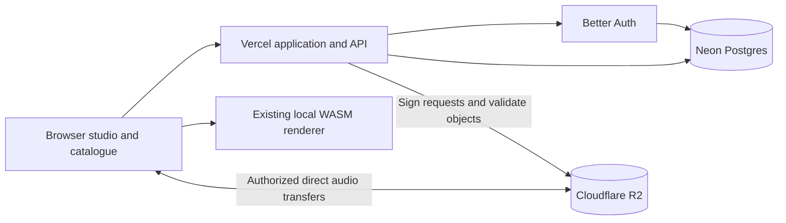

# ADR 0002: hosted audio platform, authentication and storage

Date: 2026-10-18. **Design deliverable: PASS. Implementation: PARTIAL.**
See [local account implementation and gates](../web-accounts.md).

Owner decisions: Vercel hosting, Better Auth for authentication, Neon PostgreSQL
on the Free plan, Cloudflare R2 for audio, and private generation plus a reviewed
public catalogue. The owner accepted Neon after specifying a zero-cost database
budget. A Next.js application shell is included in the accepted architecture.
The owner subsequently selected email/password sign-in and Resend for account
email. Local account implementation exists; hosted services are not provisioned
or validated. No master-spec edits.

## Product shape

The owner wants an audio-focused Artlist-like website. Artlist already includes
music alongside other assets; its music page exposes genre, mood, theme and
instrument filters. The useful reference is discovery plus a usable library,
not its asset catalogue, licensing promises or visual identity.
[Artlist music reference](https://artlist.io/royalty-free-music).

Proposed Djayvo areas:

| Area | First useful behavior |
| --- | --- |
| Create | Existing voice-to-music studio; anonymous local creation remains available |
| My library | Signed-in, private cloud-saved tracks, favourites and personal playlists |
| Discover | Reviewed tracks, genre/mood/instrument filters, BPM/duration, search and previews |
| Track page | Player, creator attribution, metadata and permitted download/use information |
| Review | Internal queue for submissions, rights/consent scope, accept/reject reasons and removal |

Use one persistent player across navigation and a compact list of real audio
tracks. Public indexing must contain approved/public tracks only. Personal
playlists remain private initially. No fabricated catalogue, metrics or quality
claims. Public licensing, monetization and creator payouts are later product
decisions; selecting this catalogue model does not authorize those features.

Generation, saving and publishing are three separate actions:

1. **Make music:** local WASM generation, preserving the existing prototype.
2. **Save to account:** explicit upload of selected finished mixes, private by
   default. Explain that these mixes can contain a recognisable voice. Sign-in
   alone must not upload the existing local library.
3. **Submit to catalogue:** explicit submission with publication permission,
   then review. Only acceptance makes a track discoverable and eligible for any
   configured public preview/download rights. Account ownership alone is not
   proof that every input can be published or licensed to others.

Original voice recordings stay local by default. Saving a finished mix does not
include the raw input, transcripts or unrelated browser history. Permission to
process locally, save remotely, publish and train are distinct scopes; training
remains off. Existing M1 musical-quality requirements remain open.

## Service boundaries

| Component | Recommendation | Responsibility |
| --- | --- | --- |
| Application and API | Vercel; Next.js shell, Node runtime for auth/API | Pages, catalogue queries, session checks, authorized upload/download requests |
| Authentication | Better Auth in our backend | Sign-in, sessions, provider accounts and verification; records in Postgres |
| Account email | Resend | Verification and password reset; server-side sending credentials |
| Application database | Neon PostgreSQL Free | Owners, tracks, object references, tags, playlists, review states, permission and usage records |
| Audio/object storage | R2 Standard | WAV masters, later compressed previews, waveform files and optional cover images |
| Generation | Existing browser WASM worker | Reuse portable C++ engine, keep generation off the API request path |
| Later processing | Separate bounded background executor | Verified media decoding/transcoding and waveform extraction when required; not an assumed Vercel/edge FFmpeg capability |

R2 is object storage. It is suitable for file bytes, while Postgres supplies the
queryable relationships and transactional state. Do not put WAV blobs in SQL or
implement accounts/playlists as mutable JSON files in R2. Better Auth has an
official PostgreSQL adapter and Next.js integration. Neon has Vercel-managed,
Neon-managed and manual integration options, including preview branching.
[Better Auth PostgreSQL](https://better-auth.com/docs/adapters/postgresql),
[Next.js integration](https://better-auth.com/docs/integrations/next),
[Neon/Vercel](https://neon.com/docs/guides/vercel-overview).

Postgres is my recommendation because a catalogue needs relational filtering,
ownership checks, ordered playlists and transactions around storage accounting.
Start with indexed metadata queries and PostgreSQL full-text search, then measure
before adding a separate search service. D1 remains an alternative for a
Cloudflare-hosted backend, but adds a less direct database path to the proposed
Vercel application. Its documented paid per-database cap is 10 GB; that is a
metadata limit, not the reason to put audio in object storage.
[PostgreSQL search](https://www.postgresql.org/docs/current/textsearch.html),
[D1 limits](https://developers.cloudflare.com/d1/platform/limits/).

## Initial logical data model

This is a model for review, not SQL migrations or a version-pinned auth schema.
Generate Better Auth's tables from the chosen, pinned configuration at
implementation time; do not hand-design replacement password/session tables.

| Records | Key relationships and fields |
| --- | --- |
| Better Auth user/session/account/verification | Managed by Better Auth; product records reference its user ID |
| profiles | User ID, display name, optional reviewed public creator handle |
| generation_runs | Owner, engine version, seed, strategy set; no raw voice by default |
| tracks | Owner, optional generation run, title, strategy, duration, BPM/key, visibility, review status, created/deleted timestamps |
| track_assets | Track, immutable server-chosen object key, kind, bytes, verified media metadata, hash, validation state |
| upload_intents | Owner, reserved bytes, staging key, expiry, idempotency key, state; only issued after authorization |
| tags / track_tags | Controlled genre/mood/instrument taxonomy and many-to-many track associations |
| playlists / playlist_tracks | Owner and ordered membership; unique track membership per playlist |
| favourites | Unique user/track pair |
| consent_records | Owner/track, permission scope, policy version, timestamp, withdrawal; restricted access |
| review_events | Track, reviewer, action, reason and timestamp; application-enforced reviewer role |
| storage_usage / cleanup_tasks | Transactional used/reserved bytes and retryable deletion/expiry work |

Use foreign keys, unique constraints and indexes, including owner/created for
libraries, approved-public/created for discovery, tag/track associations and
playlist/position. Uploaded audio and source-derived details never enter the
public search document automatically. Keep asset validation state, track
visibility and review status separate: a technically valid file is not approved
for publication. Search and playback authorize against authoritative records.

## Audio transfer and publication

Vercel documents a **4.5 MB function request/response payload limit**. A current
32-second stereo PCM16 48 kHz master contains 6,144,000 PCM bytes, before headers.
The browser therefore sends audio directly to R2; Vercel handles small control
requests. Do not proxy whole WAV uploads/downloads through application functions.
[Vercel limits](https://vercel.com/docs/functions/limitations).

1. Authenticated API validates track ownership, permitted asset kind, declared
   byte size, quota and request rate; reserves capacity transactionally and creates
   a unique staging upload intent. Owner identity comes from the session.
2. API issues a short-lived presigned PUT for that exact staging object. Credentials
   remain server-side. Configure CORS for approved app origins and needed headers;
   CORS is not authorization. Development/preview must use isolated resources.
3. Browser uploads directly and sends an idempotent completion request. Client
   hashes, MIME types and reported duration are untrusted. Verify stored bytes,
   type, duration and integrity on a bounded server-side validation path. A HEAD
   request checks object existence/size, not audio validity.
4. Publish an immutable finalized object reference only after validation. Presigned
   PUTs can be reused until expiry, so do not expose the still-writable staging key
   as the final asset. Promote to a distinct server-owned immutable key, validate
   that final snapshot, then commit asset readiness and quota accounting. Retries
   must not duplicate tracks or charge quota twice.
5. Keep unfinished/rejected objects private. Expire upload intents, release
   reservations and remove abandoned objects through retryable cleanup. A signed
   PUT alone is not proof of a hard ingress-size cap; validate real sizes and
   enforce issuance/byte budgets. Test provider-specific enforcement before launch.

Private playback/download checks ownership or explicit entitlement before issuing
a short-lived signed GET. Store object keys, never expiring signed URLs, in SQL.
Validate Range/seek behavior in target browsers. Signed URLs are bearer access
until expiry; application logout alone cannot revoke an issued URL immediately.

For an approved public catalogue, publish only designated preview objects to a
separate public bucket/custom domain. Keep originals and private mixes in a
private bucket. Do not turn an entire account library public to get CDN caching.
R2 S3 presigned URLs work on its S3 endpoint, not on custom domains. Any protected
custom-domain streaming gateway would be a separately justified component.
[R2 signed URLs](https://developers.cloudflare.com/r2/api/s3/presigned-urls/),
[R2 CORS](https://developers.cloudflare.com/r2/buckets/cors/).

Retain WAV masters; choose compressed preview codecs/encoding infrastructure only
after compatibility, licence and quality checks. Initial private sync can reuse
WAV playback. Do not falsely label client-uploaded files as verified Djayvo engine
output: technical media checks do not attest origin or publication rights.

## Auth, environments and deletion

Use Better Auth session validation in every protected API. Enforce product access
in the database query/handler; authentication alone does not permit another user's
track. Restrict review actions to server-authorized reviewers. Use separate
development/preview/production DB branches, R2 buckets/credentials and auth
secrets; no copying production voices into preview environments. Align database
and API regions where practical and use a connection strategy supported by the
chosen adapter/driver. Prove transaction semantics and pooling in a deployment
spike before selecting an ORM or committing migrations.

Start with a single supported sign-in method, adding email verification/reset only
with a configured transactional email service if password sign-in is selected.
Do not enable every social provider, team management or billing plugin by default.
Explicit local-to-account import must be retry-safe and keep the local copy until
remote verification succeeds. Cross-user session switching must not auto-import
the previous person's local library.

Deletion immediately hides tracks and prevents new signed grants. A retryable
task removes masters, previews and derivatives and reconciles storage usage;
public-preview removal also purges applicable caches. Document signed-link expiry,
backup retention and already-downloaded copies rather than claiming instantaneous
global erasure. Account deletion revokes sessions and schedules owned-data cleanup.
Neon/R2 do not share an atomic transaction: use explicit states and reconciliation.

## Cost and rollout

**Owner budget constraint:** keep the database on Neon Free. No paid upgrade or
billable add-on without explicit owner approval. Measure database size, compute
and transfer usage; staying below a storage limit alone is insufficient. Keep
audio out of Postgres, paginate queries, cache public catalogue responses and
clean up expired sessions/upload intents. Add usage thresholds and graceful
cloud-save limits before launch; preserve local generation and downloads when
cloud capacity is unavailable. Never silently delete saved tracks to fit a quota.
Free operation requires bounded usage and is not a promise of unlimited service.
Recheck provider allowances before provisioning; R2 and Vercel budgets are
separate. Budget controls and capacity measurements are **NOT RUN**.

R2 charges storage and operations, with no R2 egress-bandwidth charge. Other
metered services in the delivery path can still charge. This favours direct R2
delivery for a listening/download catalogue, but does not make the whole platform
free. Budget Vercel, Postgres, storage, requests, email and any preview processing;
set per-account byte limits and abuse controls before enabling uploads.
[R2 pricing](https://developers.cloudflare.com/r2/pricing/).

Implement in this order:

1. Preserve the current studio/fixtures and put the selected application shell
   around the same WASM engine; separate preview/production configuration.
2. Better Auth + Postgres, migrations and owner-isolation tests.
3. Explicit private cloud save, R2 upload/finalization, replay/download and deletion.
4. Reviewed catalogue, search/filters, creator/track pages, playlists and player.
5. Public release only after real service/browser tests, recovery tests, rights
   review and existing human-quality/product acceptance. Monetization later.

Acceptance before release: unauthenticated/other-user access denial; two-account
isolation; expired/replayed upload handling; wrong-size/format rejection; quota
concurrency; crash/retry across object/SQL steps; interrupted migration; preview
isolation; deletion retries; no private rows/objects leaking into catalogue or
caches; auth sign-out/recovery; playback/seek and download in supported browsers.

| Gate | Status |
| --- | --- |
| Current-doc research and reviewable architecture proposal | PASS |
| Owner choice: Vercel, Better Auth, Neon Free, R2, Next.js, private generation + reviewed catalogue | PASS |
| Deployment configuration, capacity measurements and budget controls | NOT RUN |
| Auth/database implementation and integration tests | PARTIAL — local account/Postgres/browser checks pass; live Neon/Resend not run |
| R2 implementation and integration tests | PARTIAL — adapter/local storage tests pass; live R2 not run |
| Reviewed catalogue, player and private playlists | PARTIAL — [local implementation and tests](../reviewed-catalogue.md) pass; hosted publication/moderation not run |
| Provisioning, paid services, migration and deployment | NOT RUN |
| Musical quality / production acceptance | PARTIAL — prior gates unchanged |

Research used official sources above; Context7 MCP was unavailable in this session.
The proposal does not provision resources, publish content or claim live integration.
